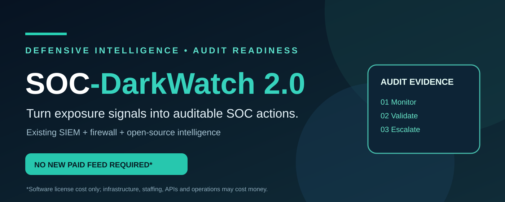
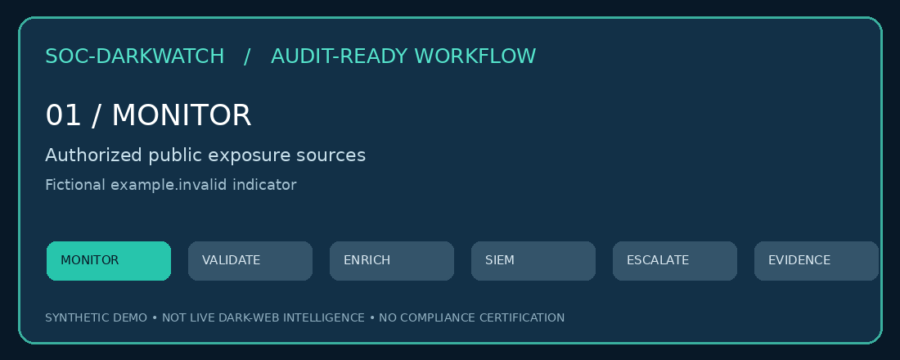
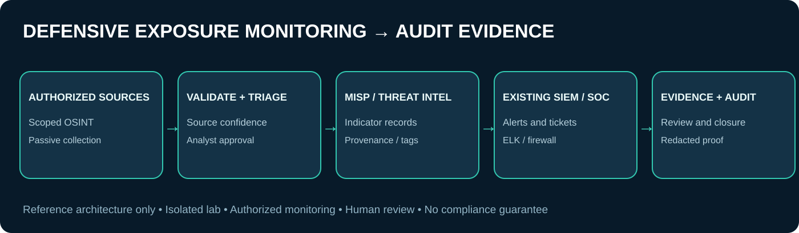

<div align="center">



# SOC-DarkWatch
### Open-source dark-web exposure monitoring · SOC integration · Audit evidence readiness

   

**Start with the security stack you already operate. Build measurable external-exposure monitoring without requiring a new commercial dark-web monitoring subscription.**

[Deployment roadmap](#four-phase-deployment-roadmap) · [Regulatory and framework mapping](docs/compliance-mapping.md) · [Audit evidence kit](docs/audit-evidence.md) · [Cost and coverage realities](#cost-and-coverage-realities)

</div>

## 🎞️ Visual walkthrough

<div align="center">


*Animated conceptual workflow using fictional findings. Not a screenshot of a live deployment.*


</div>

## Why this matters to organizations and auditors

An organization may already operate a SIEM, firewall, ticketing system, endpoint controls, and threat-intelligence workflows yet have **limited visibility into externally exposed credentials, brand impersonation, and breach mentions**. SOC-DarkWatch provides a **practical starting point** to add a documented monitoring process to that existing environment.

For audit preparation, it can help demonstrate that the organization has **defined monitoring scope, assigned ownership, reviewed potential exposure, escalated validated findings, retained appropriate evidence, and tracked remediation**. Those records are more meaningful than simply claiming to own a monitoring tool.

**This project is a phased implementation blueprint, not a deployed dark-web intelligence service.** Monitoring results, actual coverage, and audit acceptance depend on local implementation, approvals, evidence quality, and auditor/regulator interpretation. **Using SOC-DarkWatch alone does not establish compliance or satisfy a mandatory dark-web monitoring obligation.**

### What the proposed workflow adds

| Existing capability | Proposed SOC-DarkWatch contribution | Evidence to retain |
|---|---|---|
| ELK / existing SIEM | Correlate validated external-exposure indicators with internal telemetry | Detection rules, sample alerts, event lineage |
| FortiGate / existing firewall | Segment the research environment and log controlled egress | Approved policy, change record, firewall logs |
| MISP / existing TI repository | Normalize and track validated exposure indicators | Indicator records, confidence, source provenance |
| SOC ticketing / case management | Assign investigation, escalation and closure | Ticket, timestamps, disposition, approval |
| Security governance | Define authorization, ownership, cadence and review | SOP, scope, training and management sign-off |

## Frameworks and regulations: 12 mapped references

**7 Indian regulatory, legal and sector references** plus **5 international standards/frameworks** are mapped in [the applicability and evidence matrix](docs/compliance-mapping.md). This is **control-alignment guidance**, not a claim that all twelve explicitly require dark-web monitoring.

| Regulatory / sector references (7) | Standards / frameworks (5) |
|---|---|
| CERT-In Directions, 2022 | ISO/IEC 27001:2022 |
| SEBI CSCRF, 2024 | ISO/IEC 27090 *(scope requires confirmation)* |
| RBI IT Governance / Cybersecurity directions | MITRE ATT&CK |
| Digital Personal Data Protection Act, 2023 | ISO/IEC 42001:2023 |
| NSE / BSE technology or systems-audit requirements | NIST Cybersecurity Framework 2.0 |
| NPCI / UPI security requirements | |
| SEBI PFUTP Regulations, 2003 | |

**Important distinctions:** applicability depends on entity type and current amendments; some references are indirect or conditional. ISO/IEC 27090 should **not** be presented as an established dark-web monitoring requirement without verifying the exact publication, title and relevance. PFUTP concerns fraudulent/unfair securities-market practices, not a general dark-web monitoring mandate. AI management requirements under ISO/IEC 42001 apply only where an AI management system is in scope. See the matrix for qualifications and source links.

## Four-phase deployment roadmap

| Phase | Deliverable | Exit gate |
|---|---|---|
| [1 — Lab and governance](phase-1-lab-setup.md) | Segmented environment, tool training, written authorization | Legal/security sign-off |
| [2 — Single-client pilot](phase-2-pilot.md) | Scoped monitoring, validation and triage | Measured false positives, SOC sign-off |
| [3 — SIEM / MISP integration](phase-3-integration.md) | Evidence-backed findings and case routing | End-to-end synthetic finding test |
| [4 — Managed operations](phase-4-scale.md) | Recurring monitoring, reporting and improvement | Documented KPIs and periodic review |

The original four phases contain **69 implementation checklist actions**. These are planned tasks, **not completed controls**.

## Audit-ready evidence pack

Use [docs/audit-evidence.md](docs/audit-evidence.md) to prepare an audit trail with: authorization and scope, monitoring policy, inventory of existing security tools, source limitations, scheduled review records, validated findings, ticket/alert lineage, escalation records, remediation evidence, retention rules, and management review. Use **synthetic or redacted** examples in public documentation.

## Cost and coverage realities

**$0 incremental commercial dark-web monitoring license is possible**, where the organization uses suitable free/open-source software and **already-owned** compute, SIEM, firewall and ticketing infrastructure. This is **not $0 total cost**: hosting, storage, network egress, staff time, maintenance, legal review, API access, support and operational security still have costs. Some data sources require subscriptions, keys, rate limits or paid API tiers. Existing ELK and FortiGate licenses may also incur costs.

Open sources **cannot guarantee complete dark-web visibility**: private forums, closed communities, ephemeral leaks and paid breach datasets may be inaccessible. Track blind spots explicitly and do not promise parity with commercial intelligence providers.

## Architecture and responsible use

Read [architecture](docs/architecture.md) and [governance](docs/governance.md). Use isolated systems, written authorization, passive and lawful collection, minimum necessary data, access controls, and redacted evidence. Do not obtain stolen datasets, purchase access, interact with illicit markets, or test third-party systems without authorization.

> **Project status:** Implementation blueprint and documentation. This repository does **not** currently ship an automated live monitoring engine, a validated production deployment, or a certification of regulatory compliance.

## Project structure

```text
SOC-DarkWatch/
├── README.md
├── phase-1-lab-setup.md
├── phase-2-pilot.md
├── phase-3-integration.md
├── phase-4-scale.md
├── docs/
│   ├── architecture.md
│   ├── governance.md
│   ├── compliance-mapping.md
│   └── audit-evidence.md
├── assets/
│   ├── darkwatch-hero.svg
│   ├── darkwatch-architecture.svg
│   └── darkwatch-workflow.gif
└── scripts/
    └── generate_visuals.py
```

## License

MIT — see [LICENSE](LICENSE). This project is for legitimate, authorized defensive security and audit-readiness activities only.
